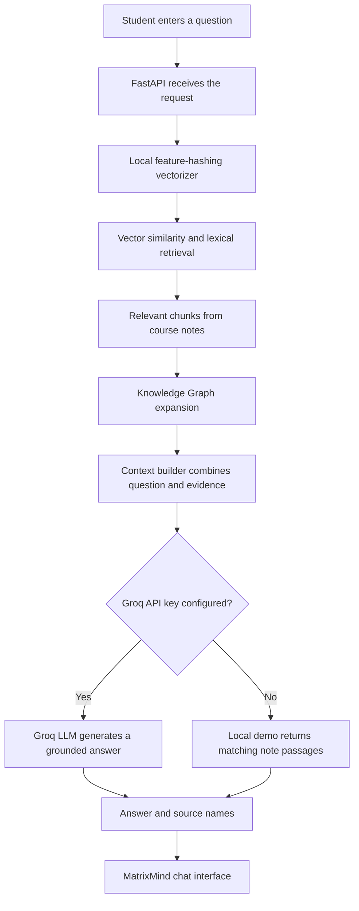
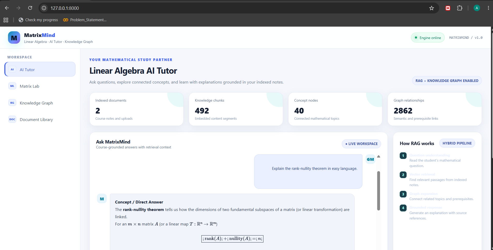
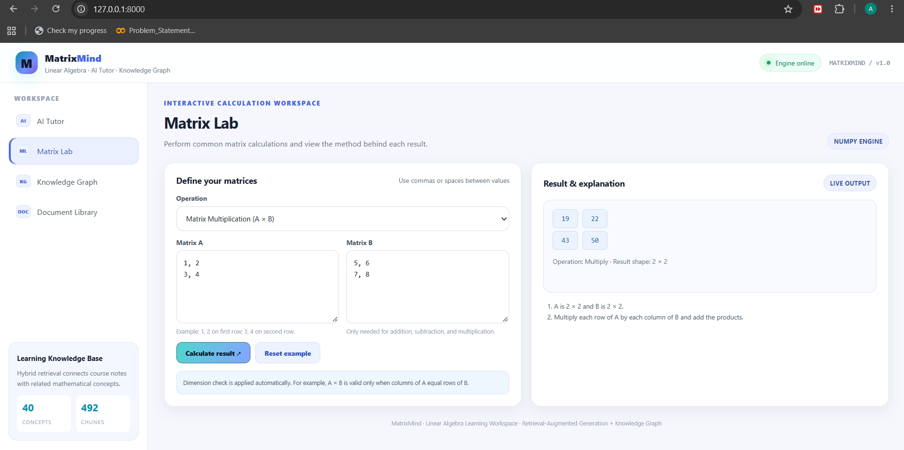

# MatrixMind — Linear Algebra AI Workspace

<p align="center">
  <strong>An AI-powered learning workspace for understanding, computing, and exploring Linear Algebra.</strong>
  <br />
  <em>Matrix Lab · RAG-based AI Tutor · Knowledge Graph · Document Library</em>
</p>

---

## Table of Contents

- [Project Overview](#project-overview)
- [Key Features](#key-features)
- [How MatrixMind Works](#how-matrixmind-works)
- [Technology Stack](#technology-stack)
- [Interface Previews](#interface-previews)
- [Project Structure](#project-structure)
- [Getting Started on Windows](#getting-started-on-windows)
  - [Prerequisites](#prerequisites)
  - [Option 1 — Automatic Setup](#option-1--automatic-setup-recommended)
  - [Option 2 — Manual Setup](#option-2--manual-setup)
- [Enable AI-Generated Answers with Groq](#enable-ai-generated-answers-with-groq)
- [Useful API Endpoints](#useful-api-endpoints)
- [Example Matrix Calculation](#example-matrix-calculation)
- [Run the Tests](#run-the-tests)
- [Limitations and Notes](#limitations-and-notes)
- [Academic Project Summary](#academic-project-summary)

---

## Project Overview

**MatrixMind** is a browser-based Linear Algebra learning environment that brings together numerical matrix computation, **Retrieval-Augmented Generation (RAG)**, and a subject-specific **Knowledge Graph**.

Instead of providing only a matrix calculator, MatrixMind helps students explore mathematical concepts, perform calculations, ask questions in natural language, and retrieve information from their own course material.

The application is served locally by a **FastAPI** backend and can be opened in a web browser at:

> **http://127.0.0.1:8000**

## Key Features

### 1. Linear Algebra Matrix Lab

The Matrix Lab uses **NumPy** to perform validated matrix operations:

- Matrix addition, subtraction, and multiplication
- Matrix transpose
- Determinant, inverse, rank, and trace
- Eigenvalues
- Reduced Row Echelon Form (RREF)
- Solving a square linear system, `Ax = b`
- Frobenius norm

The API checks matrix dimensions and input validity. When an operation is undefined, it returns a clear error instead of attempting an invalid calculation. Results are accompanied by a short explanation of the method.

### 2. RAG-Based AI Tutor

Students can ask Linear Algebra questions in natural language. MatrixMind follows this process:

1. Converts the question into a local feature-hashing vector representation.
2. Retrieves relevant text chunks from indexed notes using vector similarity and lexical overlap.
3. Uses connected Knowledge Graph concepts to expand the retrieved context when graph-enhanced retrieval is enabled.
4. Sends the question and retrieved context to **Groq** for a generated, source-grounded answer when `GROQ_API_KEY` is configured.
5. Displays the answer along with the names of the retrieved source documents.

**Local demo mode:** Matrix calculations, document indexing, Knowledge Graph navigation, and local retrieval work without a Groq API key. In this mode, the tutor displays matching passages from the notes; it does not generate a new LLM-written explanation. Add a Groq key to enable AI-generated answers.

### 3. Linear Algebra Knowledge Graph

The application uses **NetworkX** to represent mathematical topics and their relationships.

- **Document nodes** represent uploaded textbooks, lecture notes, and starter course material.
- **Concept nodes** represent topics such as matrices, determinants, Gaussian elimination, rank, vector spaces, basis, linear transformations, eigenvalues, orthogonality, and least squares.
- **Document–chunk edges** use the `CONTAINS` relationship.
- **Chunk–concept edges** use the `MENTIONS` relationship.
- **Concept–concept edges** represent co-occurrence and curated mathematical relationships such as `REQUIRES`, `PRODUCES`, `DEFINES`, and `REPRESENTED_BY`.

The graph has two roles: it powers the interactive Knowledge Graph workspace and provides related concepts for graph-enhanced RAG retrieval.

### 4. Document Library

Students can upload their own course material in the following formats:

`PDF` · `DOCX` · `PPTX` · `TXT` · `MD`

The ingestion pipeline extracts document text, divides it into overlapping chunks, creates local vector representations, identifies mathematical concepts, and updates the Knowledge Graph. Uploaded files are stored under `data/raw/uploads/` and indexed locally.

### 5. Conversation History

MatrixMind includes a conversation-history API backed by **SQLite**. It stores conversations and their messages, including source references, so previous study sessions can be retrieved and managed.

### 6. Browser-Based Workspace

The interface provides four main workspaces:

| Workspace | Purpose |
|---|---|
| **AI Tutor** | Ask questions and receive retrieved or AI-generated explanations. |
| **Matrix Lab** | Perform matrix operations and inspect calculation results. |
| **Knowledge Graph** | Explore mathematical concepts and their relationships. |
| **Document Library** | Upload, index, and manage course notes. |

---

## How MatrixMind Works

### Student Query Processing

When a student submits a question, MatrixMind retrieves supporting information before calling the LLM. The query is **not sent directly to the LLM without context**.



### Document Indexing Workflow

Uploaded documents are prepared locally so they can be searched later:


---

## Technology Stack

| Layer | Technology | Role |
|---|---|---|
| Frontend | HTML, CSS, JavaScript, SVG | Browser-based user interface |
| API and server | Python, FastAPI, Uvicorn | Application routes and local web server |
| Matrix computation | NumPy | Numerical matrix operations |
| Vector retrieval | Local feature hashing, NumPy cosine similarity | Represent and retrieve relevant text chunks |
| Retrieval enhancement | Lexical overlap | Helps match domain-specific mathematical terms |
| Knowledge Graph | NetworkX | Stores concepts, documents, and relationships |
| Document ingestion | PyMuPDF, python-docx, python-pptx | Extracts text from supported document formats |
| AI generation | Groq API (optional) | Generates answers from retrieved context |
| Conversation history | SQLite | Stores conversations and messages |

The local vectorization engine does **not** download a transformer embedding model. This keeps installation lightweight and allows local indexing and retrieval without a hosted embedding service. Groq is used only for generated tutor answers and requires an API key.

---

## Interface Previews

The following images are static previews of the application interface. The live application is served locally by FastAPI.

| AI Tutor | Matrix Lab |
|---|---|
|  |  |

---

## Project Structure

```text
MatrixMind/
├── app/
│   ├── main.py
│   ├── config.py
│   ├── state.py
│   ├── logger.py
│   ├── routes/
│   │   ├── algebra.py
│   │   ├── chat.py
│   │   ├── documents.py
│   │   ├── graph.py
│   │   ├── health.py
│   │   ├── history.py
│   │   └── v3.py
│   └── static/
│       └── index.html
├── configs/
│   └── settings.yaml
├── data/
│   ├── raw/
│   │   ├── linear_algebra_fundamentals.txt
│   │   └── uploads/
│   ├── processed/
│   └── knowledge_graph/
├── previews/
│   ├── AI_Tutor_UI_Preview.png
│   └── Matrix_Lab_UI_Preview.png
├── scripts/
│   ├── build_index.py
│   └── ingest.py
├── src/
│   ├── embeddings/
│   │   └── embed_documents.py
│   ├── ingestion/
│   │   ├── chunker.py
│   │   └── load_documents.py
│   ├── knowledge_graph/
│   │   └── graph_store.py
│   ├── llm/
│   │   ├── prompt_templates.py
│   │   └── qa_chain.py
│   ├── retrieval/
│   │   └── retriever.py
│   └── utils/
│       ├── config.py
│       └── logger.py
├── tests/
│   ├── test_algebra.py
│   └── test_linear_algebra_graph.py
├── .env.example
├── .gitignore
├── .python-version
├── requirements.txt
├── requirements-dev.txt
├── run.ps1
├── QUICK_START.txt
└── README.md
```

---

## Getting Started on Windows

### Prerequisites

- Windows 10 or Windows 11
- Python 3.11 recommended. Python 3.12/3.13 should also work with the current dependencies.
- Internet access for the initial Python package installation.
- Internet access and a Groq API key only if you want Groq-generated tutor answers.

### Option 1 — Automatic Setup (Recommended)

1. Extract the project ZIP file.
2. Open PowerShell in the extracted `MatrixMind` project folder.
3. Run:

```powershell
Set-ExecutionPolicy -Scope Process -ExecutionPolicy Bypass
.\run.ps1
```

The `run.ps1` script creates the `.venv` virtual environment if needed, installs the dependencies, creates `.env` from `.env.example` when it does not exist, and starts the FastAPI server.

When the server starts, open:

**http://127.0.0.1:8000**

Keep the PowerShell window open while using the application. Press `Ctrl + C` in that window to stop the server.

### Option 2 — Manual Setup

Open PowerShell in the project folder and run these commands one by one.

```powershell
# 1. Move into the extracted project folder
cd "C:\path\to\MatrixMind"

# 2. Create a Python virtual environment
py -3.11 -m venv .venv

# 3. Allow script activation in this PowerShell window
Set-ExecutionPolicy -Scope Process -ExecutionPolicy Bypass

# 4. Activate the virtual environment
.\.venv\Scripts\Activate.ps1

# 5. Upgrade pip and install dependencies
python -m pip install --upgrade pip
pip install -r requirements.txt

# 6. Create .env only if it does not already exist
if (-not (Test-Path .env)) {
    Copy-Item .env.example .env
}

# 7. Optional: open .env to configure Groq
notepad .env

# 8. Start MatrixMind
python -m uvicorn app.main:app --host 127.0.0.1 --port 8000 --reload
```

Replace `C:\path\to\MatrixMind` with the actual folder path on your computer. If the Python launcher does not recognize `-3.11`, install Python 3.11 or use the Python version available on your system to create the virtual environment.

### Application and API Documentation

| Resource | URL |
|---|---|
| MatrixMind application | <http://127.0.0.1:8000> |
| Interactive API documentation | <http://127.0.0.1:8000/api/v1/docs> |
| Alternative API documentation | <http://127.0.0.1:8000/api/v1/redoc> |

The starter Linear Algebra notes are indexed during the first application startup when the local knowledge graph has not yet been built.

---

## Enable AI-Generated Answers with Groq

Groq integration is optional. Without a key, MatrixMind still supports matrix calculations, local retrieval, document ingestion, Knowledge Graph navigation, and conversation-history features.

To enable generated tutor explanations:

1. Create an API key from the [Groq Console](https://console.groq.com/).
2. Open the `.env` file in the project root. If it does not exist, run the application once or copy `.env.example` to `.env`.
3. Add your key and model configuration:

```dotenv
GROQ_API_KEY=gsk_your_key_here
LLM_MODEL=openai/gpt-oss-120b
```

4. Save `.env` and restart the application.

> **Security note:** Never share your API key, upload your `.env` file, or commit it to a public Git repository. Keep `.env` private.

---

## Useful API Endpoints

All endpoints below are served locally under the `/api/v1` prefix.

| Method | Endpoint | Purpose |
|---|---|---|
| `GET` | `/api/v1/health` | Check API and model status |
| `POST` | `/api/v1/algebra/calculate` | Perform a matrix calculation |
| `POST` | `/api/v1/chat/query` | Submit a question to the RAG tutor |
| `POST` | `/api/v1/chat` | Chat endpoint |
| `GET` | `/api/v1/graph/nodes` | Retrieve Knowledge Graph nodes and links |
| `GET` | `/api/v1/graph/node/{node_id}` | Retrieve details for a graph node |
| `GET` | `/api/v1/documents` | List indexed documents |
| `GET` | `/api/v1/documents/status` | Check document and graph indexing status |
| `POST` | `/api/v1/documents/upload` | Upload and index study material |
| `GET` | `/api/v1/history` | List saved conversations |
| `GET` | `/api/v1/docs` | Open interactive Swagger API documentation |

---

## Example Matrix Calculation

The following PowerShell example sends two matrices to the multiplication endpoint.

```powershell
$body = @{
    operation = "multiply"
    matrix_a = @(
        @(1, 2),
        @(3, 4)
    )
    matrix_b = @(
        @(5, 6),
        @(7, 8)
    )
} | ConvertTo-Json -Depth 5

Invoke-RestMethod `
    -Uri "http://127.0.0.1:8000/api/v1/algebra/calculate" `
    -Method Post `
    -ContentType "application/json" `
    -Body $body
```

**Expected matrix product:**

```text
[[19, 22],
 [43, 50]]
```

---

## Run the Tests

Activate the virtual environment, then install the development dependencies and run the test suite:

```powershell
pip install -r requirements-dev.txt
python -m pytest -q
```

The tests cover the matrix calculation functionality and Linear Algebra Knowledge Graph behavior.

---

## Limitations and Notes

- **Local retrieval quality:** The feature-hashing vectorizer is compact and offline-friendly, but it is not as semantically rich as a large transformer embedding model. Domain-term extraction and lexical scoring help improve retrieval for Linear Algebra material.
- **No-key tutor mode:** Without a Groq API key, the tutor displays retrieved passages. It does not generate a new LLM-written explanation.
- **Matrix size:** The Matrix Lab limits each matrix dimension to 12 rows or 12 columns for browser-demo safety and responsiveness.
- **Starter knowledge base:** The included notes provide foundational Linear Algebra content. Upload your own syllabus, textbook extracts, and lecture notes to expand the knowledge base.
- **Educational use:** Review calculation outputs and retrieved source material as part of your coursework; the application is intended as a learning aid.

---

## Academic Project Summary

**MatrixMind demonstrates how numerical Linear Algebra, local vector retrieval, a subject-specific Knowledge Graph, document processing, and optional LLM-based explanation can be integrated into one academic learning application.**

Its Matrix Lab performs numerical calculations, the RAG pipeline retrieves relevant information from course notes, and the Knowledge Graph connects related mathematical concepts. Together, these components make MatrixMind more than a basic matrix calculator: it is an academic workspace for computing, discovering, and learning Linear Algebra.

---

<p align="center">
  <strong>MatrixMind</strong><br />
  <em>Understand the concepts. Explore the connections. Solve with confidence.</em>
</p>
